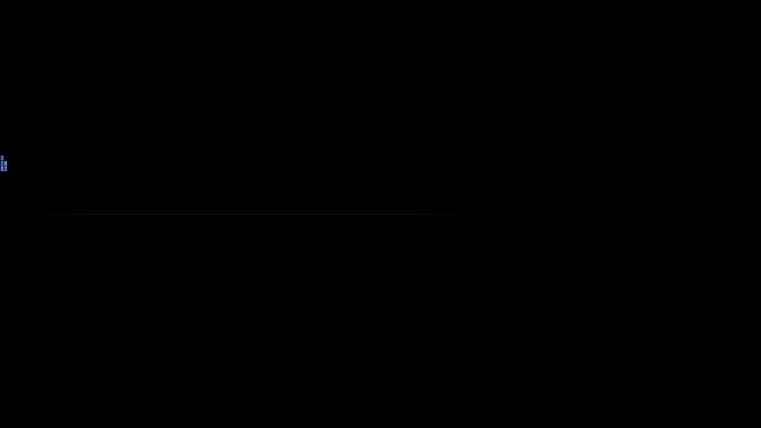

# ASCII Ocean Splash

[中文](README.zh.md) | English

A boot splash for [DeepSeek Harness](https://github.com/deepseek-ai/deepseek-harness): pure black, one thin water line, a wordmark — then four character-drawn sharks swim in and eat the wordmark letter by letter. When nothing is left, the screen holds for three seconds and fades into the app.



The sharks are not hand-drawn here: the plugin bundles a copy of the ocean renderer from [`dsh-ascii-ocean`](https://github.com/GqqQq-Q/dsh-ascii-ocean) (MIT), so they look identical to the ocean background — same square cells, same glyph ramp (`: ; t % S X 8 # @`), same spine-chain swimming.

## What it does

| Time | What happens |
| --- | --- |
| 0 – 1.7s | A 1px water line opens from the left; a faint far line appears at 32% height |
| 1.5 – 3.0s | `DEEPSEEK HARNESS` fades in |
| 0.3s / 1.5s | Two **routed** sharks enter from the screen edges (normal + 1.45×) |
| 3.0s / 3.6s | Two **free-swimming** sharks join, engine-driven, no fixed path |
| ~10 – 12s | The routed pair cross the wordmark; every cell they cover is erased permanently |
| when coverage reaches 0 | Hold pure black for **3 seconds** |
| +3s | Fade to the app over 1.8s |

Press <kbd>Esc</kbd> or click anywhere to skip.

## Install

Requires DeepSeek Harness desktop 0.2.1 (tested) and a `desktop` profile.

```bash
dsh plugin --profile desktop add github:Panna/dsh-ocean-splash
```

Or from a local checkout:

```bash
dsh plugin --profile desktop add "file:C:/path/to/dsh-ocean-splash"
```

Then fully quit and reopen Harness — a splash only plays on a cold start. On Windows, closing the window only minimizes to the tray; quit from the tray menu instead.

## Configuration

There is no settings page. Tune the constants at the top of [`lib/boot.js`](lib/boot.js):

| Constant | Meaning |
| --- | --- |
| `WORD`, `TRACKING`, `FONT_SIZE` | The wordmark and its tracking |
| `HOLD` | How long the screen stays black after the wordmark is gone (ms) |
| `FADE` | Fade-out duration (ms) |
| `SPAWNS` | The four sharks: time, routed or free, direction, size |
| `renderer.settings.sharkColor` | Shark cell colour (default `#4284FF`) |
| `renderer.settings.cellSize` | Cell size in px (default `6`) |

The 30fps frame cap and the 45-second watchdog are deliberate: the splash yields CPU to the app loading behind it, and can never leave you stuck on a black screen.

## How it works

- `index.js` runs on the host: it serves the two scripts and injects `<script src="/dsh-ocean-splash/splash.js">` into `<head>` via `webserver/index-inject`, so the overlay exists before the first paint.
- `lib/boot.js` builds a full-screen overlay, drives the timeline from the wall clock, erases the wordmark using the renderer's own shark grid, and fades out.
- `lib/ocean-renderer.js` is the bundled ocean renderer. Two changes from upstream: the "keep the headline clear" steering force is disabled (the sharks must cross the title), and the cruise speed is reduced for the splash.
- On Windows the native window buttons are hidden only while the splash runs, by making the title-bar colour probe transparent through a CSS rule; the rule is removed when the splash ends.

The plugin never touches Harness's `window.__ModuleLoader__` — the bundled renderer loads through a private `window.__DSH_OCEAN_LOADER__` hook, so client plugins keep loading normally.

## Known limitations

- Plays once per cold start; there is no replay command.
- Fixed ~16s timeline (10–12s of it is the sharks crossing).
- Windows only for hiding the native window buttons; other platforms just skip that step.
- The animation is wall-clock driven, so a suspended window resumes where the clock says it should be.

## Credits & license

MIT — see [LICENSE](LICENSE).

`lib/ocean-renderer.js` is derived from the ocean renderer in [`dsh-ascii-ocean`](https://github.com/GqqQq-Q/dsh-ascii-ocean) (MIT), which itself ports the `ascii-sharks` demo by [stackedlol](https://github.com/stackedlol/ascii-sharks). Its copyright notice is preserved by that MIT license; the modifications made here are listed under "How it works".
